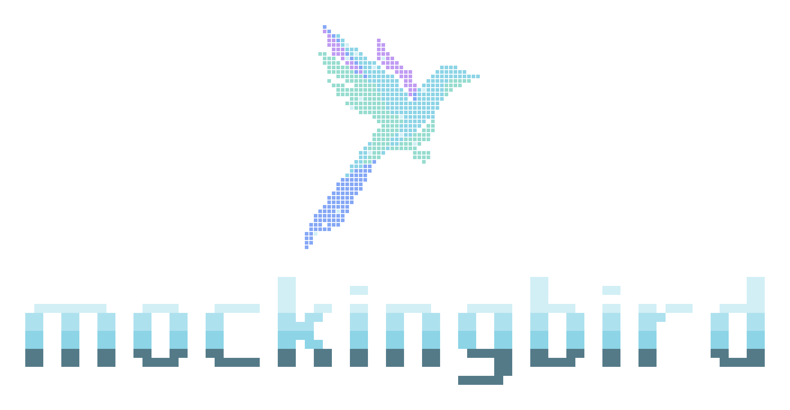
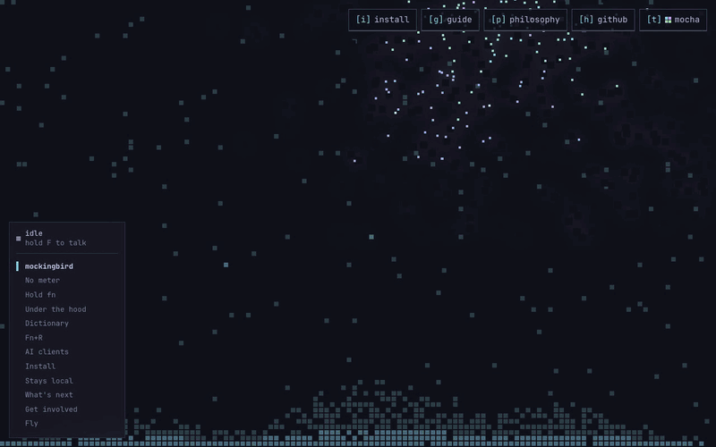

<h3 align="center">
  
</h3>

<p align="center">
  The website for <a href="https://github.com/NirjharBhattacharjee/mockingbird">mockingbird</a>, local voice dictation for macOS.<br>
  Live at <a href="https://mockingbirdvoice.org">mockingbirdvoice.org</a>.
</p>

<p align="center">
  <a href="https://mockingbirdvoice.org"></a>
  <a href="https://github.com/NirjharBhattacharjee/mockingbird-website/commits/main"></a>
  
  
  
  
</p>

<p align="center">
  
</p>

<p align="center">
  
</p>

A pixel canvas sits behind the whole page. The wordmark assembles from
scattered pixels, then morphs into a new shape for every section as you
scroll, and in the last section you can fly the bird down a road. The docs at
[/docs](https://mockingbirdvoice.org/docs) are rendered from mockingbird's own
`docs/`.

This repo is separate from the app on purpose: nothing here ships with
mockingbird, and nothing in the app depends on it.

## 🚀 Run it

You need [Bun](https://bun.sh).

```sh
bun install
bun run dev
```

Then open http://localhost:44100. `bun run dev` rebuilds the CSS and restarts
the server on change, so reload the browser after an edit.

| Command | Does |
|---|---|
| `bun run dev` | Dev server with CSS watch and restart on change |
| `bun run start` | Production mode |
| `bun run test` | Tests (under Bun, the docs need `Bun.markdown`) |
| `bun run typecheck` | Type-check |
| `bun run docs:sync` | Copy `docs/*.md` from `../mockingbird` (or `$MOCKINGBIRD_DIR`) |

## ⌨️ On the page

| Key | Does |
|---|---|
| **F** (hold) | Run the talk demo: the level meter jumps and raw speech turns into clean text. It's scripted, the page never asks for the microphone |
| **T** | Cycle the Catppuccin flavors: Mocha, Macchiato, Frappé, Latte |
| **↑ / ↓** | Move between sections |
| **I G P H** | Jump to install, the guide, the philosophy, GitHub |

## 🧭 Ground rules

From mockingbird's [philosophy](https://github.com/NirjharBhattacharjee/mockingbird/blob/main/docs/PHILOSOPHY.md):

- No analytics, trackers, cookies or third-party requests. Fonts are self-hosted.
- Never call the microphone.
- Nothing that implies a paid tier. Mockingbird is free forever.
- Respect `prefers-reduced-motion`. Every animation has a still fallback.

## 📚 More

- [AGENTS.md](AGENTS.md): project layout and how Remix 3 works here
- [CONTRIBUTING.md](CONTRIBUTING.md): checks to run, and how deploys work
- [design/MOTION.md](design/MOTION.md): motion notes

Every merge to `main` deploys to [mockingbirdvoice.org](https://mockingbirdvoice.org) on Render.

MIT, same as mockingbird.
